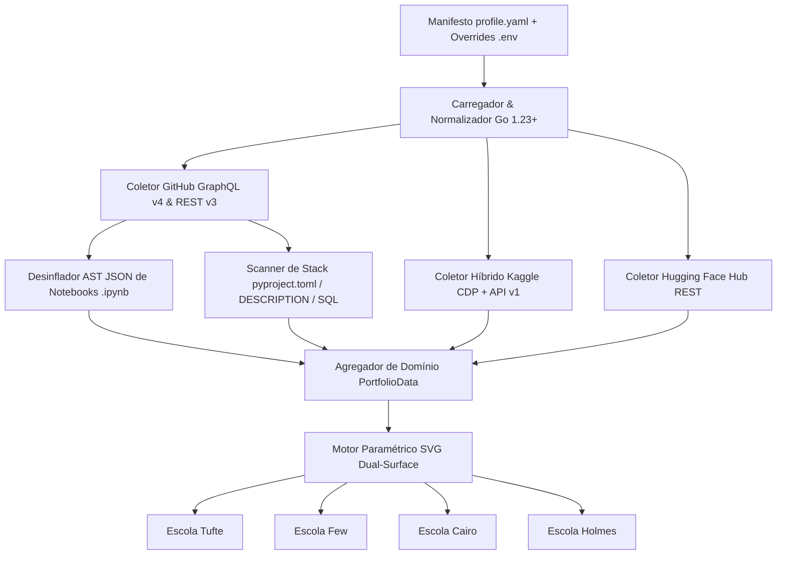


**Contexto / Organização**: Projeto Autônomo / Open Source  
**Período**: 2026 - Presente  
**Categoria de Atuação**: Data Engineering  
**Tecnologias**: `Go 1.23+`, `GitHub GraphQL v4`, `GitHub REST v3`, `Chrome DevTools Protocol (CDP)`, `Kaggle API v1`, `Hugging Face Hub API`, `SVG / SMIL`, `GitHub Actions`  

---

## Visão Geral Executiva

Motor de telemetria e visualização estatística de portfólio escrito em Go 1.23+ (biblioteca padrão, zero dependências externas) para cientistas de dados, engenheiros de machine learning e pesquisadores quantitativos. Desinfla imagens base64 e saídas de células embutidas em arquivos Jupyter Notebook (.ipynb) antes do cômputo de bytes, varre manifestos de dependências e agrega métricas do GitHub, Kaggle e Hugging Face Hub em 36 painéis SVG paramétricos nas escolas de Edward Tufte, Stephen Few, Alberto Cairo e Nigel Holmes.


**Organization / Context**: Projeto Autônomo / Open Source  
**Timeline**: 2026 - Present  
**Domain Category**: Data Engineering  
**Technologies**: `Go 1.23+`, `GitHub GraphQL v4`, `GitHub REST v3`, `Chrome DevTools Protocol (CDP)`, `Kaggle API v1`, `Hugging Face Hub API`, `SVG / SMIL`, `GitHub Actions`  

---

## Executive Overview

Portfolio telemetry and statistical visualization engine built in Go 1.23+ (standard library only, zero external dependencies) for data scientists, machine learning engineers, and quantitative researchers. Strips embedded base64 chart images and cell output payloads from Jupyter Notebooks (.ipynb) before byte counting, scans dependency manifests across the data stack, and aggregates metrics from GitHub, Kaggle, and Hugging Face Hub into 36 parameterized SVG panels across the visualization schools of Edward Tufte, Stephen Few, Alberto Cairo, and Nigel Holmes.




## Arquitetura & Fluxo de Dados

O diagrama abaixo ilustra a topologia e esteira de processamento dos componentes técnicos sanitizados:

## Architecture & Data Flow

The diagram below illustrates the sanitized high-level component topology and data processing pipeline:



## Destaques de Engenharia

- **Desinflação de Notebooks (.ipynb): Remoção de imagens base64 e metadados JSON de saída antes da contagem de código-fonte para separar notebooks exploratórios (EDA) de módulos de produção.**
- **Coleta Concorrente Multi-Plataforma: Extração paralela via GitHub GraphQL v4/REST v3, Kaggle (headless Chrome CDP combinado à REST API v1) e Hugging Face Hub.**
- **Motor SVG Paramétrico Dual-Surface: Renderização determinística de 9 painéis em 4 escolas clássicas (Tufte, Few, Cairo e Holmes), com refluxo tipográfico nativo, animações SMIL e contraste WCAG AA em temas claros (#ffffff) e escuros (#0d1117).**


## Key Engineering Highlights

- **Notebook Deflation (.ipynb): Strips embedded base64 chart payloads and JSON cell output metadata before counting source bytes to separate exploratory notebooks (EDA) from production modules.**
- **Concurrent Multi-Source Collection: Parallel ingestion across GitHub GraphQL v4/REST v3, Kaggle (headless Chrome CDP paired with REST API v1), and Hugging Face Hub.**
- **Dual-Surface Parameterized SVG Engine: Deterministic rendering of 9 panels across 4 visualization schools (Tufte, Few, Cairo, and Holmes), with native text reflow, SMIL animations, and WCAG AA contrast on light (#ffffff) and dark (#0d1117) themes.**




## Referências e Comprovações

- [Código-Fonte / Repositório Oficial no GitHub](https://github.com/pablodiegoo/dataprofile)


## References & Verification

- [Source Code / Official GitHub Repository](https://github.com/pablodiegoo/dataprofile)


